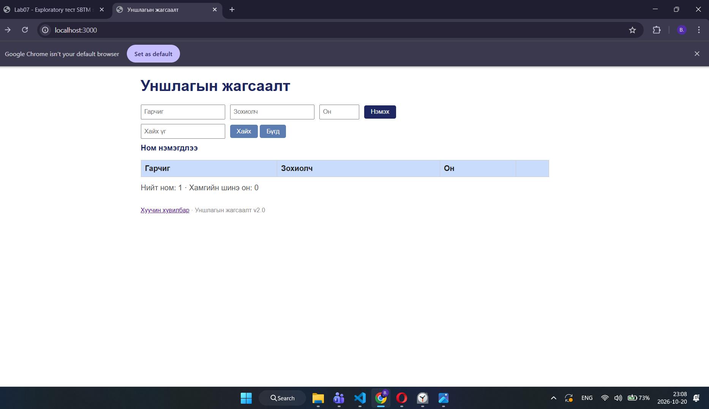

# BUG-02: Хоосон хүснэгттэй үед нийт номын тоо 1 гэж харагдаж байна

**Орчин:** Уншлагын жагсаалт v2.0, Google Chrome, Windows 11

**Урьдчилсан нөхцөл:** node app.js ажиллаж байна.

## Дахин гаргах алхам
1. http://localhost:3000 хаягийг нээнэ.
2. Бүх номыг устгаж, хүснэгтийг хоосон болгоно.
3. Статистикийн мөрийг шалгана.

**Хүлээгдэж байсан:** Нийт ном 0, хамгийн шинэ он 0 байна.

**Бодит үр дүн:** Хүснэгт хоосон байхад "Нийт ном: 1" гэж харагдсан.

**Ноцтой байдал:** Major

**Хавсралт:** screenshots/bug-02.png

**Олдсон аялал:** Fed-Ex

