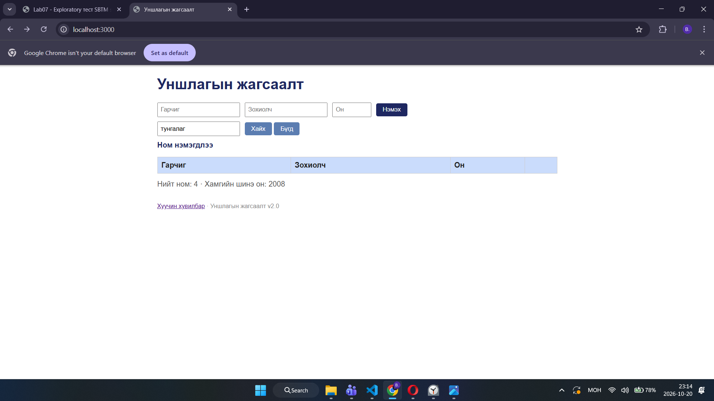

# BUG-03: Байхгүй ном хайхад статистик болон хүснэгтийн төлөв зөрж байна

**Орчин:** Уншлагын жагсаалт v2.0, Google Chrome, Windows 11

**Урьдчилсан нөхцөл:** Анхны номнууд жагсаалтад байна.

## Дахин гаргах алхам
1. Хайлтын талбарт "тунгалаг" гэж бичнэ.
2. "Хайх" товчийг дарна.
3. Хүснэгт болон статистикийн мөрийг шалгана.

**Хүлээгдэж байсан:** Хайлтын үр дүн болон статистик нь тодорхой, зөрүүгүй байна.

**Бодит үр дүн:** Хүснэгтэд мөр харагдахгүй боловч "Нийт ном: 4" гэж харагдсан.

**Ноцтой байдал:** Major

**Хавсралт:** screenshots/bug-03.png

**Олдсон аялал:** Fed-Ex

